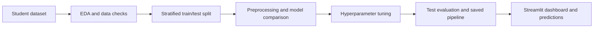
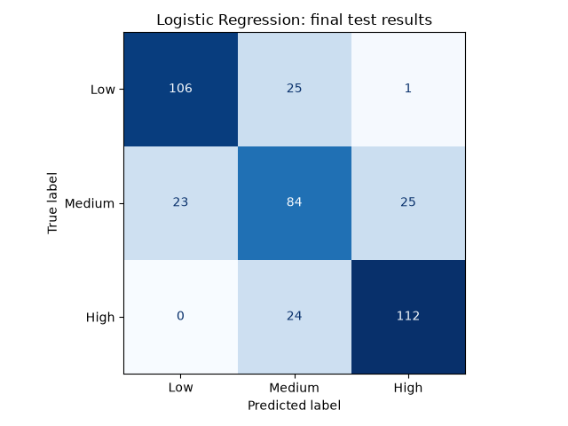

# Student Mental Health Risk Prediction

An end-to-end machine learning project that predicts **Low**, **Medium**, or **High** mental health risk categories from synthetic student data. It covers exploratory data analysis, preprocessing, model comparison, hyperparameter tuning, evaluation, workflow automation, and an interactive prediction app.

The analysis starts in Jupyter notebooks. Reusable Python scripts run the modeling workflow, an Apache Airflow DAG automates it, and Streamlit displays the results and accepts new inputs. Docker Compose runs Airflow and Streamlit together.

> **Educational use only:** the dataset is synthetic. The model is not a diagnostic or clinical screening tool and must not be used to make decisions about real students.

## Dataset

The project uses the [Student Mental Health Risk Prediction dataset](https://www.kaggle.com/datasets/maqdadali/mental-health-risk-prediction-dataset-students), included at [`data/student_mental_health.csv`](data/student_mental_health.csv).

| Property | Value |
| --- | --- |
| Records | 2,000 synthetic students |
| Original columns | 17 |
| Model inputs | 15 features, after excluding the ID and target |
| Target | `Mental_Health_Risk` |
| Classes | Low: 660, Medium: 660, High: 680 |
| Training / test split | 1,600 / 400 records, stratified by target |
| Random seed | `42` |

The inputs describe age, gender, year of study, sleep, study hours, GPA, social media use, screen time, physical activity, financial stress, family support, attendance, part-time employment, diet, and previous mental health history.

See [`data/README.md`](data/README.md) for the feature descriptions and [`project.md`](project.md) for the project requirements.

## Project workflow



### 1. Exploratory data analysis

[`notebooks/1_eda.ipynb`](notebooks/1_eda.ipynb) examines the dataset structure, descriptive statistics, missing values, duplicate records, repeated IDs, and inconsistent values. It also explores class balance, distributions, potential outliers, and numerical correlations using plots.

### 2. Preprocessing

[`notebooks/2_preprocessing.ipynb`](notebooks/2_preprocessing.ipynb) builds the preprocessing pipeline. The reusable implementation is in [`src/preprocessing.py`](src/preprocessing.py).

The data is split before fitting preprocessing. `Student_ID` is excluded because it is an identifier, and the target is separated from the input features.

| Feature group | Missing values | Transformation |
| --- | --- | --- |
| Numerical features | Median imputation | `StandardScaler` |
| Binary: part-time job, previous mental health history | Most frequent value | `No → 0`, `Yes → 1` using `OrdinalEncoder` |
| Ordinal: physical activity, diet quality | Most frequent value | Ordered encoding, then `StandardScaler` |
| Nominal: gender | Most frequent value | `OneHotEncoder`, ignoring unknown categories |

The ordinal orders are `Low < Moderate < High` for activity and `Poor < Average < Good` for diet.

Key decisions:

- **Retain plausible outliers:** IQR checks flag extreme values, but no rows are removed or capped. The saved training audit flags 50 values across 46 rows.
- **No resampling:** the three target classes are approximately balanced, so SMOTE and other balancing methods are not applied.
- **Standardize features:** scaling keeps variables with different units comparable for Logistic Regression and SVM. Standardization does not remove outliers.
- **Prevent leakage:** preprocessing stays inside each model pipeline and is fitted within the training folds during cross-validation. The test set is reserved for final evaluation.

### 3. Model training and comparison

[`notebooks/3_training.ipynb`](notebooks/3_training.ipynb) compares Logistic Regression, Random Forest, and an RBF Support Vector Machine using five-fold stratified cross-validation on the training set.

The workflow measures accuracy, weighted precision, recall, F1, and one-vs-rest ROC-AUC. Weighted F1 is the model selection metric. SVM uses probability calibration around the complete preprocessing/model pipeline.

Saved baseline cross-validation results:

| Model | Accuracy | Weighted F1 | Weighted ROC-AUC |
| --- | ---: | ---: | ---: |
| Logistic Regression | 0.7513 | 0.7509 | 0.9059 |
| SVM | 0.7162 | 0.7174 | 0.8668 |
| Random Forest | 0.6769 | 0.6733 | 0.8551 |

These are training cross-validation scores, not test-set scores. See [`reports/model_comparison.csv`](reports/model_comparison.csv).

### 4. Optimization and final evaluation

[`notebooks/4_optimization.ipynb`](notebooks/4_optimization.ipynb) tunes Logistic Regression and SVM with `GridSearchCV`, selects the best candidate by cross-validation weighted F1, and evaluates it on the held-out test set.

| Candidate | Best parameters | Tuned CV weighted F1 |
| --- | --- | ---: |
| Logistic Regression | `C=10` | 0.7519 |
| SVM | `C=10`, `gamma=0.01` | 0.7372 |

**Selected model: Logistic Regression with `C=10`.** It achieved the highest tuned cross-validation weighted F1 among the candidates.

Results on the **400-record test set**:

| Metric | Score |
| --- | ---: |
| Accuracy | 75.50% |
| Weighted precision | 75.55% |
| Weighted recall | 75.50% |
| Weighted F1 | 0.7552 |
| Weighted ROC-AUC, one-vs-rest | 0.9145 |



The saved pipeline includes both preprocessing and the classifier. Evaluation also produces a classification report, individual prediction errors, performance by gender, and false-positive/false-negative counts for the High category. In the saved test results, 24 High cases were predicted as another category and 26 other cases were predicted as High.

These results describe this synthetic dataset only. The subgroup report is exploratory; small groups, including 22 non-binary test records, do not support strong fairness conclusions. Model probabilities should not be interpreted as clinical risk probabilities.

### 5. Airflow automation

[`dags/mental_health_dag.py`](dags/mental_health_dag.py) defines the `mental_health_pipeline` DAG with three **PythonOperators**:

```text
prepare_data → train_models → evaluate_model
```

- `prepare_data` loads and splits the CSV, then logs the shapes and class balance.
- `train_models` fits preprocessing inside the model pipelines, compares and tunes models, and saves the winner.
- `evaluate_model` loads the saved pipeline, evaluates the test set, and writes reports for Streamlit.

The DAG runs weekly when enabled, with catchup disabled and one active run at a time. Airflow starts with the DAG paused so it can be triggered manually first.

### 6. Streamlit application

[`app/streamlit_app.py`](app/streamlit_app.py) provides two tabs:

- **Model results:** saved test metrics, confusion matrix, and baseline model comparison.
- **Try a prediction:** a form for all 15 features, the predicted category, and model probabilities.

The form passes inputs through the saved pipeline, including its fitted preprocessing. It also checks that social media hours do not exceed total screen time. Refresh the page after a completed Airflow run to load updated results.

## Run with Docker

Install Docker with Docker Compose, then clone the repository:

```bash
git clone https://github.com/SaiKYouBoi/mental-health-risk-prediction.git
cd mental-health-risk-prediction
docker compose up --build -d
```

| Service | Address |
| --- | --- |
| Streamlit | http://localhost:8501 |
| Airflow | http://localhost:8081 |

This setup uses two containers. Airflow runs in local `standalone` mode with SQLite. It is intended for learning and local demonstrations, with both ports bound to localhost.

### Run and inspect the DAG

1. Open Airflow and log in with username **`admin`**. Get its generated password with:

   ```bash
   docker compose exec airflow cat /opt/airflow/state/simple_auth_manager_passwords.json.generated
   ```

2. Open **`mental_health_pipeline`**, enable it, and click **Trigger**.
3. Wait for all three tasks to turn green. Open a task's **Logs** to inspect its output or a failure.
4. Open or refresh Streamlit to inspect the results and try a prediction.

You can also execute the DAG from the terminal:

```bash
docker compose exec airflow airflow dags test mental_health_pipeline
```

This command runs training and evaluation and replaces the saved model and generated reports.

### Logs, persistence, and stopping

```bash
docker compose ps
docker compose logs -f airflow
docker compose logs -f streamlit
docker compose down
```

The `models/` and `reports/` directories are shared with the containers and persist on your machine. Airflow's database, login details, and task logs persist in a Docker volume. `docker compose down` stops the services without deleting those saved files or the volume.

On Linux, the default Airflow container user is UID `1000`. If your UID differs, start the services with:

```bash
AIRFLOW_UID=$(id -u) docker compose up --build -d
```

After changing Python requirements, rebuild the affected service. For example:

```bash
docker compose up --build -d streamlit
```

The shared requirements include `dill`, which is needed to load the model saved from the Airflow environment.

## Run locally without Docker

Use a Python **3.11** environment and run these commands from the project root:

```bash
python -m pip install -r requirements-app.txt
python -m src.preprocessing
python -m src.train
python -m src.evaluate
streamlit run app/streamlit_app.py
```

The preprocessing command prints the split summary; training fits and saves the complete pipeline. Evaluation uses the same CSV and split settings, so keep them consistent with the saved model. Training and evaluation overwrite their previous outputs.

To explore the notebooks, install the additional notebook tools:

```bash
python -m pip install notebook seaborn
python -m notebook
```

Open the notebooks in order: **1 → 2 → 3 → 4**, using the same Python environment. The training and optimization notebooks reuse the preprocessing notebook. The commands above run the analysis and app locally; the Docker instructions provide the configured Airflow environment.

## Repository structure

```text
mental-health-risk-prediction/
├── data/                   # Synthetic CSV and dataset documentation
├── notebooks/
│   ├── 1_eda.ipynb
│   ├── 2_preprocessing.ipynb
│   ├── 3_training.ipynb
│   └── 4_optimization.ipynb
├── src/
│   ├── preprocessing.py    # Data split and preprocessing builder
│   ├── train.py            # Model comparison, tuning, and saving
│   └── evaluate.py         # Test metrics, plots, and error analysis
├── dags/
│   └── mental_health_dag.py
├── app/
│   └── streamlit_app.py
├── models/                 # Complete fitted pipeline and metadata
├── reports/                # Audits, metrics, predictions, and plots
├── requirements.txt        # Shared model dependencies
├── requirements-app.txt    # Shared dependencies plus Streamlit
├── Dockerfile              # Streamlit and Airflow image targets
├── compose.yaml            # Services, ports, and shared storage
├── project.md              # Detailed project requirements
└── README.md
```

## Saved deliverables

| Output | Location |
| --- | --- |
| Complete preprocessing and classification pipeline | [`models/mental_health_pipeline.joblib`](models/mental_health_pipeline.joblib) |
| Selected parameters, input columns, versions, and metrics | [`models/model_metadata.json`](models/model_metadata.json) |
| Baseline model comparison | [`reports/model_comparison.csv`](reports/model_comparison.csv) |
| Tuning comparison | [`reports/tuning_comparison.csv`](reports/tuning_comparison.csv) |
| Final test metrics | [`reports/test_metrics.json`](reports/test_metrics.json) |
| Per-class evaluation | [`reports/classification_report.json`](reports/classification_report.json) |
| Test predictions and errors | [`reports/test_predictions.csv`](reports/test_predictions.csv), [`reports/prediction_errors.csv`](reports/prediction_errors.csv) |
| Performance by gender | [`reports/gender_performance.csv`](reports/gender_performance.csv) |

The `reports/` folder also contains the saved data audit, training-data checks, grid-search results, and out-of-fold predictions from earlier analysis. The scripts refresh the files they write; they do not regenerate every historical report in that folder.

## Tools

Python 3.11, pandas, NumPy, Matplotlib, Seaborn, scikit-learn, Joblib, Dill, Jupyter, Apache Airflow, Streamlit, and Docker Compose.
